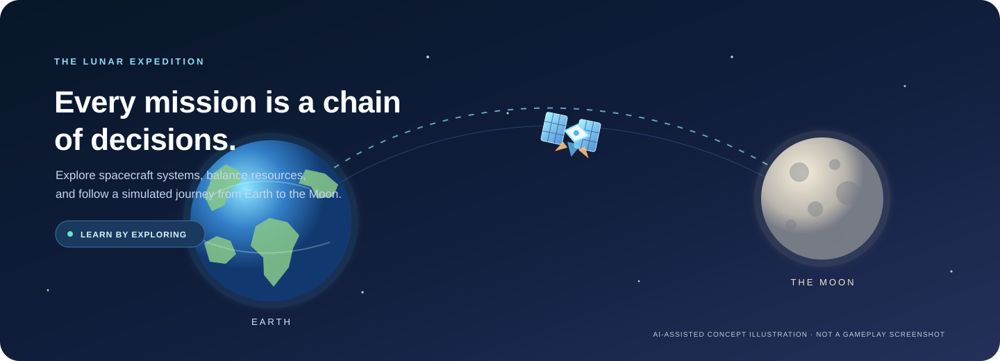
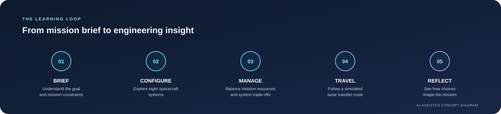
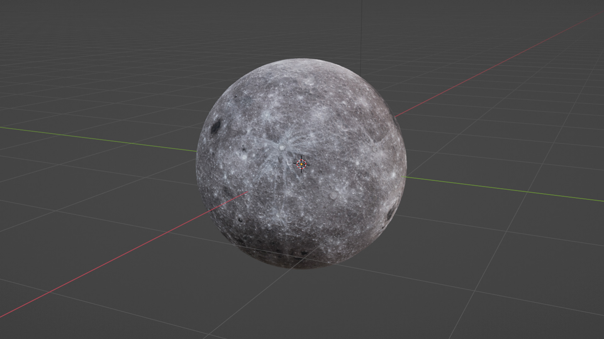

# MISSION ZERO — The Lunar Expedition

**An interactive spaceflight game about the decisions behind a journey from Earth to the Moon.**

<p align="center">
  
</p>

<p align="center">
  <a href="#play-the-windows-build">Play the Windows build</a> ·
  <a href="#how-the-experience-works">How it works</a> ·
  <a href="#nasa-data-and-resources">NASA resources</a>
</p>

## The project

MISSION ZERO is an educational 3D game made with Unity 6. It makes spacecraft engineering easier to explore through hands-on decisions: players inspect a spacecraft, configure its systems, manage mission resources, and follow a simulated expedition toward the Moon.

The project is designed to help students and curious players see how spacecraft systems work together—and how a choice made during mission planning can affect the journey that follows.

## How the experience works

<p align="center">
  
</p>

Players move through a mission briefing and spacecraft workshop, then experience a simulated Earth-to-Moon journey. The workshop introduces eight spacecraft systems:

| System | What players explore |
| --- | --- |
| Propulsion | How engines provide thrust and enable maneuvers |
| Propellant tanks | Why fuel storage matters to a mission |
| Solar panels | How a spacecraft generates electrical power |
| Batteries | How energy is stored and balanced against demand |
| Communications | How a spacecraft exchanges information with mission control |
| Navigation sensors | How position and orientation are determined |
| Landing gear | Why stability and protection matter during touchdown |
| Scientific instruments | How a spacecraft can collect observations |

Players also make configuration and resource decisions, explore different lunar-transfer routes, and encounter mission risks. The experience simplifies real engineering so that the relationships between systems are approachable; it is not a flight-dynamics simulator or a substitute for mission-design software.

## Play the Windows build

This repository contains the packaged Windows build in [`Build/`](Build/). To retrieve the complete build, including the large Unity asset, install [Git](https://git-scm.com/) and [Git LFS](https://git-lfs.com/), then clone the repository:

```bash
git lfs install
git clone https://github.com/TheMrPlax/Mission-Zero.git
```

Open `Build/Mission Zero.exe` from the cloned folder to launch the game. The Unity source project is not included in this repository.

## NASA data and resources

NASA resources give the game real planetary references for its simulated setting:

### Moon — Lunar Reconnaissance Orbiter (LRO)

The game uses NASA's **Moon_NASA_LRO_8k_Topo_Small.glb**, a 3D model made from lunar imagery and topographic data collected by the Lunar Reconnaissance Orbiter. It provides the visual Moon used to establish the expedition's destination and lunar environment. The model represents mapped lunar terrain; the game's mission decisions and travel are simplified simulations.

<p align="center">
  
</p>

NASA's Goddard Space Flight Center credits: Producer Dan Gallagher (eMITS); data provider Ernie Wright (STC); data analysts Tuomas Kankola and Josh Klint; technical support Aaron E. Lepsch (ADNET Systems, Inc.). [Resource page and full credits](https://svs.gsfc.nasa.gov/14959/).

### Earth with clouds

The game also uses NASA's [Earth with Clouds 3D Model](https://science.nasa.gov/resource/earth-with-clouds-3d-model/) (`EarthClouds_1_12756.glb`) to represent Earth in the space environment. Credit: NASA Visualization Technology Applications and Development (VTAD).

## Technology and acknowledgements

- **Unity 6** — 3D game engine and build environment.
- **C#** — gameplay and interactive systems.
- **glTFast** — imports the NASA GLB models into Unity. [Project](https://github.com/atteneder/glTFast) · Apache License 2.0.

### AI assistance

ChatGPT and Google Gemini supported coding, debugging, and development documentation. OpenAI Codex assisted with this README and the repository illustrations. The original project concept was developed by the team; the team remained responsible for design decisions, implementation, and integration. The header and mission-flow diagram are visibly labeled as AI-assisted illustrations and are not gameplay screenshots.

## Project scope

MISSION ZERO is an educational prototype. Its spacecraft systems and mission trade-offs are simplified for learning, and its 3D planetary models provide visual context rather than live NASA data feeds. This repository contains the Windows build, not the editable Unity project or a full engineering model of a real lunar mission.
